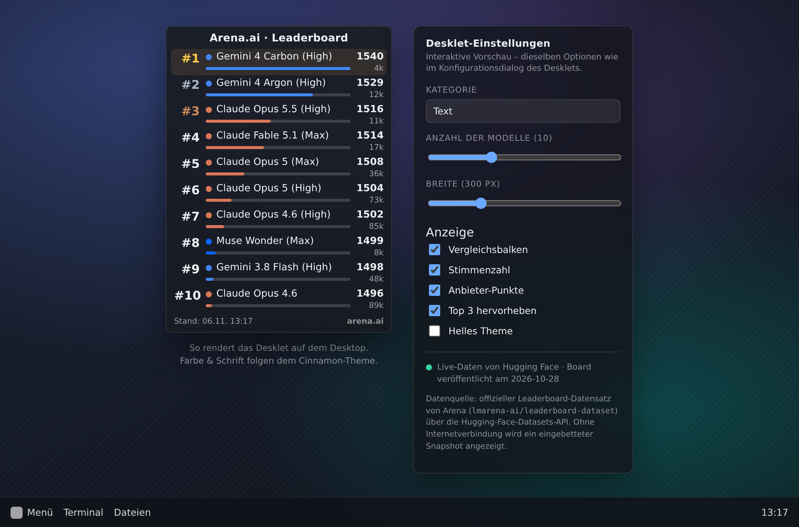

# Arena.ai Leaderboard – Cinnamon Desklet

Ein Desklet für den Cinnamon-Desktop (Linux Mint), das das **aktuelle Leaderboard von
[arena.ai](https://arena.ai/leaderboard)** direkt auf dem Desktop anzeigt – Text, WebDev,
Agent, Vision, Document, Search sowie die Bild- und Video-Boards.



## Funktionen

- **11 Leaderboards** von arena.ai: Text, WebDev, Agent, Vision, Document, Search,
  Text → Image, Image Edit, Text → Video, Image → Video, Video Edit
- Kompakt **3–25 Plätze**, Breite und Schriftgröße frei einstellbar
- **Anbieter-Farbpunkte** (Anthropic, OpenAI, Google, Meta, xAI, DeepSeek, Alibaba …)
- **Vergleichsbalken**, Stimmen- bzw. Session-Zahl, Top-3-Hervorhebung
- Agent-Board wird korrekt als **Erfolgsquote in Prozent** dargestellt (statt Rating)
- **Tooltip** pro Zeile: Anbieter, Lizenz, Rating inkl. Konfidenzintervall, Stimmen,
  bei Agent zusätzlich Kosten pro Task – und das Veröffentlichungsdatum des Boards
- **Zwei Datenquellen mit automatischem Fallback**: offizieller Hugging-Face-Datensatz
  → tägliche GitHub-Snapshots → `curl` → Cache → mitgelieferter Beispiel-Snapshot
- **Offline-fähig**: zuletzt geladene Daten werden lokal gecacht und bei fehlender
  Verbindung mit Hinweis angezeigt; notfalls greift ein mitgelieferter Snapshot
- Klick auf das Desklet = sofort aktualisieren, Rechtsklick = Kontextmenü
  („Jetzt aktualisieren“, „arena.ai im Browser öffnen“, Konfigurieren, Entfernen)
- Automatische Aktualisierung in einstellbarem Intervall (Standard: 30 Minuten)

## Installation

### Über Cinnamon

1. **Systemeinstellungen → Desklets** öffnen
2. Auf **„+“** klicken und nach **Arena.ai Leaderboard** suchen
3. Installieren und anschließend auf dem Desktop hinzufügen
4. Rechtsklick auf das Desklet → **Konfigurieren** für Kategorie und Anzeige

### Manuell

Die Zip-Datei von der Spices-Website herunterladen und über
**Systemeinstellungen → Desklets → „+“ → „Install from file“** installieren.

Alternativ lässt sich das Desklet direkt nach
`~/.local/share/cinnamon/desklets/arena-leaderboard@bienwaldcoder` entpacken.
Danach Cinnamon neu laden (`Alt+F2` → `r` → `Enter`).

## Einstellungen

| Abschnitt | Einstellung | Standard | Beschreibung |
| --- | --- | --- | --- |
| Leaderboard | **Kategorie** | Text | Welches Board angezeigt wird |
| Leaderboard | **Anzahl der Modelle** | 10 | 3–25 Plätze |
| Leaderboard | **Automatisch aktualisieren** | 30 Min. | `0` = nur manuell |
| Darstellung | **Breite** | 300 px | 180–640 px |
| Darstellung | **Schriftgröße** | 0 | `0` = Systemtheme |
| Darstellung | **Überschrift anzeigen / Text** | an / „Arena.ai · Leaderboard“ | Kopfzeile des Desklets |
| Darstellung | **Farbpunkte der Anbieter** | an | Farbe je Organisation |
| Darstellung | **Vergleichsbalken** | an | relativ zum Besten/Schwächsten |
| Darstellung | **Stimmenzahl** | an | Stimmen bzw. Sessions |
| Darstellung | **Top 3 hervorheben** | an | Gold/Silber/Bronze |
| Datenquelle | **API-Server** | `https://datasets-server.huggingface.co` | Datasets-Server |
| Datenquelle | **Datensatz** | `lmarena-ai/leaderboard-dataset` | offizieller Arena-Datensatz |
| Datenquelle | **Cache-Datei** | `~/.cache/arena-leaderboard@bienwaldcoder/leaderboard.json` | Offline-Zwischenspeicher |

## Datenquelle & Aktualität

Die Daten stammen aus dem **offiziellen Leaderboard-Datensatz von Arena**
(`lmarena-ai/leaderboard-dataset` auf Hugging Face), abgerufen über die öffentliche
Datasets-Server-API:

```
https://datasets-server.huggingface.co/rows
        ?dataset=lmarena-ai/leaderboard-dataset
        &config=<board>&split=latest&offset=0&length=10
```

Warum nicht direkt von arena.ai? Die Website ist durch Cloudflare geschützt und
antwortet auf Nicht-Browser-Anfragen mit **HTTP 403**. Der Datensatz enthält exakt
die Werte, aus denen die Web-Rangliste gebaut wird (Rating, Konfidenzintervall,
Stimmen, Rang, Veröffentlichungsdatum).

**Wichtig zur Aktualität:** Arena veröffentlicht neue Versionen der Rangliste
unregelmäßig – oft nur alle paar Tage. Das Feld `leaderboard_publish_date` zeigt
den Stand des Boards; er kann also etwas älter sein als die Live-Website.
Die Fußzeile des Desklets zeigt zusätzlich, wann die Daten *abgerufen* wurden.

### Zweite Quelle: tägliche GitHub-Snapshots

Weil Netzwerkfilter, Firewalls oder DNS-Probleme einzelne Hosts blockieren können,
probiert das Desklet der Reihe nach mehrere Quellen (Einstellung **Datenquelle**):

| Reihenfolge | Quelle | Adresse | Inhalt |
| --- | --- | --- | --- |
| 1 | Hugging Face Datasets-API | `datasets-server.huggingface.co` | offizieller Datensatz, tiefste Historie |
| 2 | GitHub-Snapshots | `raw.githubusercontent.com/oolong-tea-2026/arena-ai-leaderboards` | tägliche JSON-Snapshots (MIT), 8 Tage rückwärts |
| 3 | `curl` | Systemprogramm | Fallback, wenn libsoup streikt |
| 4 | Cache | `~/.cache/arena-leaderboard@bienwaldcoder/` | zuletzt erfolgreich geladene Daten |
| 5 | Beispiel-Snapshot | `data/fallback.json` im Desklet | mitgeliefert, funktioniert immer |

Standard ist **Automatisch** (1 → 2). Fehlschläge werden gesammelt und im Desklet
als Grund angezeigt, z. B. `Hugging Face: HTTP 500 · GitHub-Snapshot 2026-11-06: HTTP 404 …`.

> Die GitHub-Snapshots sind seit etwa dem 21.10.2026 leer, weil auch dort der
> Scraper von arena.ai blockiert wird – als Ausweichquelle bleiben sie trotzdem
> nützlich, und der Parser ist gegen beide Formate getestet.

Die Hugging-Face-API liefert zwei Zeilentypen, die das Desklet automatisch unterscheidet:

| Typ | Boards | Werte |
| --- | --- | --- |
| `rating` | Text, WebDev, Vision, Document, Search, Image/Video-Boards | Bradley-Terry-Rating (z. B. `1540`), `vote_count` |
| `score` | Agent | Erfolgsquote 0–1 (Anzeige als `20.14 %`), `session_count`, `cost_per_task_p50` |

## Bedienung

| Aktion | Wirkung |
| --- | --- |
| Linksklick | Daten sofort neu laden |
| Rechtsklick | Kontextmenü (Aktualisieren, Browser öffnen, Konfigurieren, Entfernen) |
| Mauszeiger über einer Zeile | Details: Anbieter, Lizenz, Rating + Konfidenzintervall, Stimmen, Kosten, Board-Datum |
| Mauszeiger über „Stand: …“ | Anzahl Modelle im Datensatz, Board-Veröffentlichung |
| Klick auf „arena.ai“ in der Fußzeile | Leaderboard im Browser öffnen |

## Fehlersuche

Bei Problemen zeigt das Desklet den Grund direkt an. Für Details:

1. **Rechtsklick auf das Desklet → „Verbindung testen …“**
   Es erscheint eine Benachrichtigung mit dem Ergebnis, und ein Protokoll wird
   geschrieben nach `~/.cache/arena-leaderboard@bienwaldcoder/diagnostics.log`:

   ```
   Ergebnis:      OK
   Detail:        10 Einträge empfangen (Gemini 4 Carbon (High)) · HTTP 200
   Backend:       libsoup 3 (send_and_read_async)
   System:        Cinnamon 6.4.0 · GJS 1.82.3 · libsoup 3.6
   curl:          /usr/bin/curl
   ```

2. **Cinnamon-Log** (dort loggt das Desklet Start, Backend und Fehler):

   ```bash
   journalctl --user -b -f | grep -i arena       # oder ~/.xsession-errors
   ```

3. **Kein Internet?** Dann zeigt das Desklet die zuletzt gespeicherten Daten mit
   dem Hinweis „⚠ Offline – zeige gespeicherte Daten“.

### libsoup 2.4 vs. 3.0

Cinnamon-Desklets holen ihre Daten über `imports.gi.Soup`. Je nach Distribution
und Cinnamon-Version ist das **libsoup 2.4** oder **libsoup 3.0** – mit völlig
unterschiedlicher API:

| | libsoup 2.4 | libsoup 3.0 |
| --- | --- | --- |
| Anfrage | `session.queue_message()` | `session.send_and_read_async()` |
| Antwort | `message.response_body.data` | `GLib.Bytes` aus `send_and_read_finish()` |
| Abbruch | `session.cancel_message()` | `Gio.Cancellable` |

Das Desklet erkennt das automatisch (`createHttpFetcher`) und dekodiert UTF-8 in
beiden Fällen selbst. Schlägt der Transport trotzdem fehl, wird einmalig auf
`curl` ausgewichen; über die Einstellung **„curl statt libsoup verwenden“** lässt
sich das dauerhaft erzwingen.

## Kompatibilität & bekannte Grenzen

- Entwickelt und geprüft für **Cinnamon 5.x / 6.x** (Linux Mint 20.3–22).
  Für Cinnamon 4.x gibt es einen Kompatibilitäts-Shim (`bindProperty` statt `bind`).
- Benötigt eine Internetverbindung beim ersten Start; danach funktioniert die
  Anzeige aus dem Cache auch offline.
- Die angezeigten Ratings sind **keine Momentaufnahme der Website**, sondern der
  zuletzt veröffentlichte Stand des Datensatzes (siehe oben).
- Schreibt nur in `~/.cache/arena-leaderboard@bienwaldcoder/`; keine Telemetrie,
  keine weiteren Netzwerkzugriffe.
- Alle sichtbaren Strings laufen über `_()` und können übersetzt werden.

## Lizenz & Hinweis

Lizenz: **GPL-3.0-or-later**.

Dieses Desklet ist ein **inoffizielles Hobby-Projekt** und steht in keiner
Verbindung zu Arena.ai. „arena.ai“, Modellnamen und Marken gehören ihren
jeweiligen Rechteinhabern. Die Daten werden unverändert vom öffentlichen
Datensatz bezogen; für deren Richtigkeit wird keine Gewähr übernommen.

## Changelog

**1.2.0** – mehr Quellen, Diagnose im Desklet
- zweite Datenquelle: tägliche GitHub-Snapshots (`oolong-tea-2026/arena-ai-leaderboards`)
  mit Automatik-Kette HF → GitHub → curl → Cache → mitgeliefertem Snapshot
- mitgelieferter Beispiel-Snapshot `data/fallback.json` (alle 11 Boards), damit das
  Desklet nie leer bleibt
- Anfrage-Timeout (25 s) statt ggf. endlosem „Lade …“
- Fehlermeldung nennt jetzt alle versuchten Quellen samt HTTP-Status, Version und Backend
- Bugfix: Konfidenzintervall der Agent-Scores wurde nicht mitnormiert

**1.1.0** – Fehlerbehebung „Daten konnten nicht geladen werden“
- HTTP-Schicht unterstützt libsoup **2.4 und 3.0**
- UTF-8-Dekodierung für `GLib.Bytes` inkl. Umlauten
- automatischer Fallback auf `curl`, optional per Einstellung erzwingbar
- Kontextmenü: **„Verbindung testen …“** mit Benachrichtigung und Protokoll
- Tooltip mit exakter Stimmenzahl

**1.0.0** – erste Version: 11 Boards, Cache, Auto-Refresh, Vorschau, Tests
