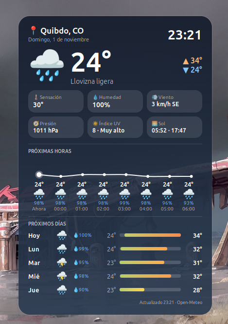

# Clima Pro

Desklet de pronóstico del tiempo para **Cinnamon (Linux Mint)**. Muestra el clima actual, una curva de temperatura por horas y el pronóstico de varios días, con un fondo que cambia según el clima y la hora del día.

Los datos vienen de [Open-Meteo](https://open-meteo.com), que es gratuito y no necesita API key.



## Características

- **Clima actual:** icono, temperatura, descripción, máxima y mínima del día.
- **Detalles:** sensación térmica, humedad, viento (con dirección), presión, índice UV y hora de amanecer y atardecer.
- **Próximas horas:** curva suavizada de temperatura (de 4 a 12 horas) con probabilidad de lluvia.
- **Próximos días:** de 3 a 7 días, con barras de rango de temperatura que cambian de color según el calor.
- **Fondo dinámico:** cielo despejado, noche, nublado, niebla, lluvia, nieve o tormenta.
- **Temas:** automático (según el clima), oscuro, claro y cristal translúcido.
- **Personalizable:** idioma (español o inglés), unidades métricas o imperiales, opacidad, tamaño y reloj de 12 o 24 horas.
- **Varias instancias:** puedes añadir hasta 3, por ejemplo una por ciudad.

## Requisitos

- Linux Mint con Cinnamon.
- `curl`, que ya viene instalado en Linux Mint.
- Conexión a internet.

## Instalación

1. Descomprime el paquete en la carpeta de desklets del usuario:

   ```bash
   unzip -o ~/Descargas/clima-pro@largacha.zip -d ~/.local/share/cinnamon/desklets/
   ```

   Si tienes la carpeta suelta, cópiala así:

   ```bash
   cp -r "clima-pro@largacha" ~/.local/share/cinnamon/desklets/
   ```

2. Clic derecho en el escritorio, luego **Añadir desklets**.
3. Busca **Clima Pro** y pulsa el botón de añadir.
4. Si no aparece en la lista, reinicia Cinnamon con `Ctrl+Alt+Esc` y repite el paso 2.

La carpeta debe llamarse exactamente `clima-pro@largacha`.

### Si tenías la primera versión (`clima-pro@desklet`)

El desklet cambió de identificador. Quita el anterior (clic derecho sobre él, **Eliminar**), borra su carpeta con `rm -rf ~/.local/share/cinnamon/desklets/clima-pro@desklet`, instala esta versión y añádela de nuevo. Los ajustes se reinician.

## Configuración

Clic derecho sobre el desklet y luego **Configurar**.

| Opción | Descripción |
| --- | --- |
| Ciudad | Nombre de la ciudad. Si se deja vacía, se detecta por tu conexión a internet. |
| Unidades | Métrico (°C, km/h) o imperial (°F, mph). |
| Actualizar cada | Intervalo de actualización, de 10 a 180 minutos. |
| Idioma | Español o English. |
| Tema | Automático, oscuro, claro o cristal translúcido. |
| Opacidad del fondo | De 30 % a 100 %. |
| Tamaño | De 70 % a 150 %. |
| Mostrar detalles | Activa o desactiva el bloque de sensación, humedad, viento, presión, UV y sol. |
| Curva por horas y horas a mostrar | Activa la curva y elige cuántas horas muestra (4 a 12). |
| Próximos días y días a mostrar | Activa el pronóstico diario y elige cuántos días muestra (3 a 7). |
| Reloj de 24 horas | Cambia el formato de la hora. |

Desde el menú del clic derecho también puedes elegir **Actualizar / Refresh** para forzar una actualización.

## Privacidad

- Si dejas la ciudad vacía, el desklet consulta `ipwho.is` para estimar tu ubicación a partir de tu IP. Si prefieres evitarlo, escribe tu ciudad en la configuración.
- Si escribes una ciudad, se busca con la API de geocodificación de Open-Meteo.
- El pronóstico se pide a `api.open-meteo.com`.
- No se guarda ni se envía nada más.

## Solución de problemas

**No aparece en la lista de desklets.**
Verifica que la ruta sea `~/.local/share/cinnamon/desklets/clima-pro@largacha/` y que dentro estén `desklet.js`, `metadata.json`, `settings-schema.json`, `stylesheet.css` e `icon.png`. Luego reinicia Cinnamon con `Ctrl+Alt+Esc`.

**Dice "No se pudo obtener el clima".**
Revisa tu conexión y comprueba que `curl` funcione:

```bash
curl -sS "https://api.open-meteo.com/v1/forecast?latitude=4.6&longitude=-74.1&current=temperature_2m"
```

El desklet reintenta solo cada 2 minutos.

**Dice "Ciudad no encontrada".**
Prueba con el nombre sin abreviaturas, o déjalo vacío para detectar la ubicación automáticamente.

**Los iconos se ven como cuadros.**
Instala la fuente de emojis a color:

```bash
sudo apt install fonts-noto-color-emoji
```

**Ver errores del desklet.**
Abre Looking Glass con `Alt+F2`, escribe `lg` y entra en la pestaña **Errors**. Los mensajes del desklet empiezan con `ClimaPro`.

## Desinstalar

Clic derecho en el desklet y **Eliminar**. Para borrar los archivos:

```bash
rm -rf ~/.local/share/cinnamon/desklets/clima-pro@largacha
```

## Estructura

```
clima-pro@largacha/
├── desklet.js            # Lógica, red y dibujo
├── icon.png              # Icono que se ve en la lista de desklets
├── screenshot.png        # Captura para el README y la publicación
├── metadata.json         # Datos del desklet
├── settings-schema.json  # Opciones de configuración
├── stylesheet.css        # Estilos base
└── README.md
```

## Créditos

- Autor: @largacha
- Datos meteorológicos y geocodificación: [Open-Meteo](https://open-meteo.com).
- Estimación de ubicación por IP: [ipwho.is](https://ipwho.is).
