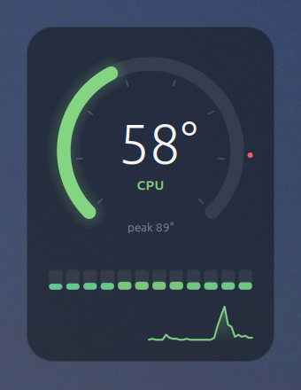

# CPU Temp Ring

A minimal, modern CPU temperature desklet for Cinnamon.

## Features

- **Ring gauge** (30–100 °C) whose colour shifts smoothly from teal → green → amber → red as the CPU heats up
- **Smoothly animated** temperature readout with a session **peak** marker
- **Per-core bars**, each coloured by its own temperature
- **History sparkline** of the last 60 samples
- HiDPI-aware, adjustable size, background opacity, font, °C / °F and refresh interval

## Sensor support

Reads directly from sysfs, with no extra packages needed:

- Intel: `coretemp` (package + per-core temperatures)
- AMD: `k10temp` / `zenpower` (Tctl/Tdie)
- Fallback: the most CPU-like ACPI thermal zone (`x86_pkg_temp`, `TCPU`, `cpu`, `soc`…)

If no sensor is found, the desklet shows "No sensor".

## Settings

Right-click the desklet → **Configure** to change size, refresh interval, units, per-core bars, sparkline, background opacity and font.
