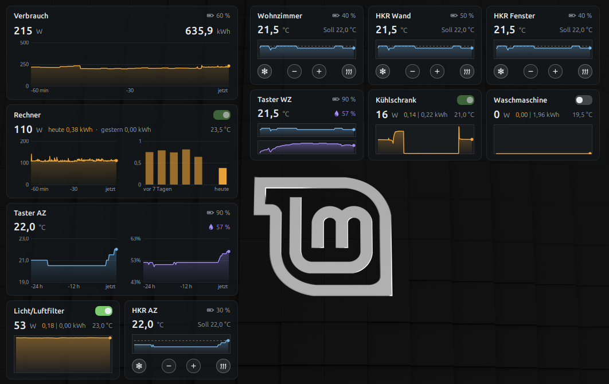

# Domilume

Your FRITZ!Box smart home at a glance: plugs, thermostats, sensors and energy meter as tiles
with history graphs.

## Features

- **Tiles for your FRITZ!Box smart home devices** in a grid. You choose the devices, their order
  and which ones get a large full-width tile.
- **Smart plugs:** current power, energy today and yesterday, temperature, a graph of the last
  hour and a switch. Plugs locked in the FRITZ!Box are shown, but cannot be switched.
- **Radiator thermostats and heating groups:** room temperature, set point, a 24 h temperature
  graph and buttons for frost protection, −/+ 0.5 °C and boost. Durations are set per device.
- **Buttons with sensors** (e.g. FRITZ!Smart Control 440): temperature and humidity with graphs.
- **FRITZ!Smart Energy 250 energy meter:** consumption with meter reading and power graph, feed-in
  as a separate device.
- **Large tiles** with axes and energy bars for the last 7 days, 31 days or 12 months.
- **Tooltips:** values at any point of a graph; energy today, yesterday and a yearly projection,
  with costs if you enter your electricity price.
- **Battery level** on every battery device, highlighted when low.
- **Several desklets** can share one FRITZ!Box connection (one poll for all), for example one per
  screen.
- Desktop notifications when the connection is lost or restored and when the box does not
  confirm a command.
- English and German.

## Requirements

- FRITZ!Box with FRITZ!OS 7.24 or newer
- A FRITZ!Box user with the “Smart Home” permission (FRITZ!Box: System → FRITZ!Box Users)
- A Secret Service provider such as GNOME Keyring (installed by default on Linux Mint)

## Setup

1. Add the desklet to the desktop and open its settings.
2. **Connection:** click **Search automatically** (or enter the address, e.g. `fritz.box`),
   then **Set credentials…** and enter the FRITZ!Box user and password.
3. **Devices:** once connected, the list shows all devices of the box. Tick **Show** for the tiles
   you want and **Large** for full-width tiles; ▲ ▼ set the order on the desktop.
   Double-click a thermostat row to change its boost and frost protection minutes.
4. **Appearance:** number of columns, tile width, background opacity and the period of the
   energy bars.

The FRITZ!Box address, the credentials, the refresh interval and the electricity prices are
stored once and apply to all Domilume desklets. User name and password are kept in the keyring
(Secret Service), never in a settings file.

## Notes

- The devices send new measurements about every 1–2 minutes; the refresh interval (default
  30 s) mainly affects how fast switch states appear.
- Energy values and graphs come from the statistics the FRITZ!Box keeps itself; the desklet
  records nothing.
- The FRITZ!Smart Energy 250 currently delivers no daily energy statistics, so its tiles show
  the meter reading and power, but no energy bars.
- Costs and the yearly projection are estimates (energy of the last 30 days × your price).

## Translations

The desklet uses gettext; the template is `files/domilume@gfrhd/po/domilume@gfrhd.pot`.
Translations are welcome.

## Disclaimer

Domilume is an independent project and is not affiliated with or endorsed by AVM.
FRITZ!, FRITZ!Box and FRITZ!DECT are trademarks of AVM.
