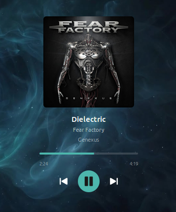

# Music Now Playing

Shows what your music player is playing, with its album art, right on the desktop, and controls
it.

## Use

1. Add the desklet: System Settings → Desklets → Music Now Playing → Add.
2. Play something in your music player. Audacious is the one it looks for first; set another in
   Configure → Player.

It shows the track's album art, title, artist, and album and year when the player gives them.
Below are a progress bar to drag, click or scroll, the elapsed and total time, and previous,
play / pause and next. Shuffle and repeat show too, for players that offer them over MPRIS
(Audacious doesn't).

Click the album art to bring the player's window up, or, when it isn't running, to start it.
The right-click menu does the same.

## Players

It works with any player that supports MPRIS, the standard way Linux media players share what
they're playing: Audacious, Rhythmbox, Strawberry, Clementine, Lollypop, VLC, Spotify, and
web browsers playing media, among others. For Audacious, the "MPRIS 2 Server" plugin must be on
(Audacious → Settings → Plugins → General); it is by default.

When several players are running, it shows the one playing, preferring the one in Configure →
Player. When none is playing, it shows that one, or else one that's paused. The player name is
the end of its MPRIS bus name (`org.mpris.MediaPlayer2.audacious` → `audacious`).

## Appearance

Configure sets the width (the album art fills it), the corner radius, and the background's
opacity, down to none at all. The colours come from your Cinnamon theme (System Settings →
Themes → Desktop), with the progress bar and play button in its accent colour, and change with
it.

Album art is kept as a smaller copy in `~/.cache/musicnowplaying@tacojones/`, the 50 most recent.

## Requirements

Nothing beyond Cinnamon and a player that supports MPRIS. The desklet plays no sound itself:
the player does.
