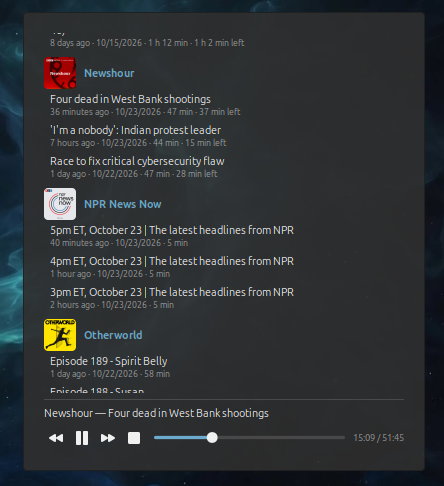

# Podcasts

Follows podcast feeds and plays their latest episodes, right on the desktop.

## Use

1. Add the desklet: System Settings → Desklets → Podcasts → Add.
2. Right-click it → Configure, and add each podcast's feed (RSS) address. A name is optional;
   the feed's own title is used otherwise.
3. Click an episode to play it. Below the list are a progress bar to drag or click, back and
   forward 10 seconds, pause and stop, and the elapsed and total time. Stop part way and the
   episode carries on from there next time; the list shows how much of it is left.

The feeds are checked again every hour by default (Configure → Check feeds every), or at once
with Refresh in its right-click menu, which also shows when they were last checked.

Configure also sets the size, the corner radius, and the background's opacity, down to none at
all so the episodes sit straight on the wallpaper. The colours come from your Cinnamon theme.
Each feed's cover art shows beside its title (Configure → Show cover art); it is downloaded
once into `~/.cache/podcasts@tacojones/`.

It starts with a few podcasts to try: BBC Global News Podcast, 99% Invisible, In Our Time,
Radiolab, NASA's Houston We Have a Podcast and LINUX Unplugged. Remove or add any in Configure.

Its sound shows as "Podcasts" in System Settings → Sound → Applications, with a volume of its
own.

## Requirements

Playback uses GStreamer's `playbin`, and episodes stream through the HTTP source in
`gstreamer1.0-plugins-good`. Mint installs both by default.
