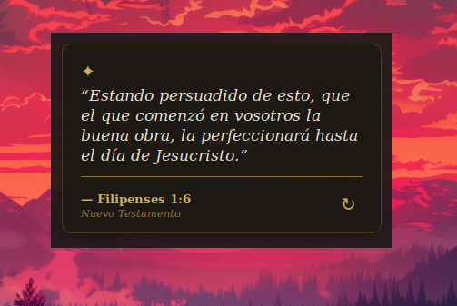

# Promesas Bíblicas

**Promesas Bíblicas** is a Cinnamon desklet that displays a daily Bible promise on your desktop. It offers a peaceful and inspiring reminder of God's promises, with a design that can be fully customized to match your desktop theme.

## Features

*   **Daily Promise:** A new Bible promise is selected automatically every day based on the date.
*   **Manual Refresh:** Click the refresh button to read another promise at any time.
*   **Themes:** Includes three preset themes: *Parchment*, *Stained Glass*, and *Modern*.
*   **Full Customization:** Change background color, text color, accent color, fonts, sizes, and opacity.
*   **Auto Dark/Light Mode:** Automatically adapts to your system's GTK theme.
*   **Adjustable Layout:** Change the width, text alignment, and toggle the ornament and divider.

## Installation

1. Download or clone this repository.
2. Copy the `promesas-biblicas@largacha` folder to `~/.local/share/cinnamon/desklets/`.
3. Restart Cinnamon (Press `Alt + F2`, type `r`, and press `Enter`).
4. Right-click on your desktop, select **Add desklets**, and choose **Promesas Bíblicas**.

## Configuration

Right-click on the desklet and select **Configure** to open the settings window. From there, you can:
*   Choose a preset theme or create your own custom color palette.
*   Select the font family and size for the quote and the author.
*   Adjust the background transparency and corner radius.
*   Set the refresh frequency (daily, hourly, or manual).

## Translations

If you want to help translate this desklet, you can use the `cinnamon-spices-makepot` tool available in the Cinnamon Spices repository.

## Credits

*   Bible promises text and references.
*   Created by [Largacha77](https://github.com/Largacha77).

## License

This project is licensed under the GPL-3.0 License.

