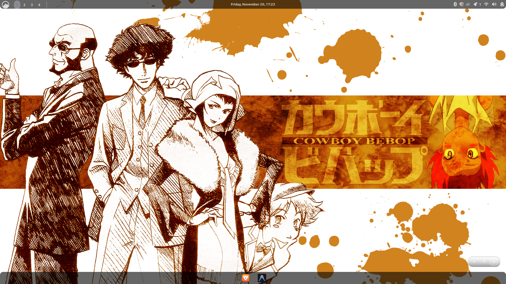

# Wallpaper Switcher

A minimal, floating wallpaper controller desklet for Cinnamon Desktop with a frosted glass backdrop and automatic slideshow timer.



## Features

- **Minimal UI**: Translucent floating glass pill (`←   ⏸   →`).
- **Controls**:
  - `←` : Previous wallpaper
  - `⏸` / `▶` : Pause or resume automatic slideshow
  - `→` : Next wallpaper
- **Slideshow Timer**: Automatically advances wallpapers at configurable intervals (1 min, 5 min, 10 min, 15 min, 30 min, 1 hour, or Custom).
- **Native Cinnamon Integration**: Sets desktop background directly through Cinnamon's native desktop background settings (`org.cinnamon.desktop.background picture-uri`). No external daemons, shell scripts, or wallpaper managers required.
- **Robust**: Gracefully handles missing directories, empty folders, single files, and deleted files.
- **Right-Click Settings**: Configurable wallpaper directory and slideshow interval via native Cinnamon desklet settings dialog.

---

## Installation

### Option 1: Direct Installation (Works immediately)

You can install it directly from GitHub using these commands:

```bash
# 1. Clone the repository
git clone https://github.com/Rajarshirexx/wallpaper-switcher.git /tmp/wallpaper-switcher

# 2. Install into your user desklets folder
mkdir -p ~/.local/share/cinnamon/desklets/wallpaper-switcher@rajarshirexx
cp -r /tmp/wallpaper-switcher/files/wallpaper-switcher@rajarshirexx/* ~/.local/share/cinnamon/desklets/wallpaper-switcher@rajarshirexx/

# 3. Clean up
rm -rf /tmp/wallpaper-switcher
```

**To enable the desklet:**
1. Right-click any empty space on your desktop and select **"Add Desklets"** (or open **System Settings → Desklets**).
2. In the **Manage** tab, select **Wallpaper Switcher**.
3. Click the **`+`** (Add) button at the bottom.
4. Drag the controller to your preferred spot on your desktop.

---

### Option 2: Via Cinnamon Spices (Once published)

1. Open **System Settings → Desklets**.
2. Click the **Download** tab.
3. Search for **Wallpaper Switcher** and click **Install**.
4. In the **Manage** tab, select **Wallpaper Switcher** and click **`+`**.

---

## Configuration

1. **Right-click** on the desklet and select **"Configure..."**.
2. **Wallpaper Directory**: Choose the folder containing your wallpapers (defaults to your localized Pictures/Wallpapers folder).
3. **Slideshow Interval**: Select a preset interval (1m, 5m, 10m, 15m, 30m, 1h) or choose **Custom** to set any interval in seconds.

---

## Uninstallation

To remove the desklet:

```bash
rm -rf ~/.local/share/cinnamon/desklets/wallpaper-switcher@rajarshirexx
```
